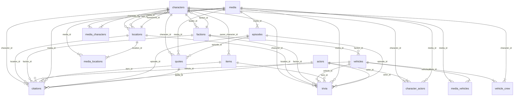
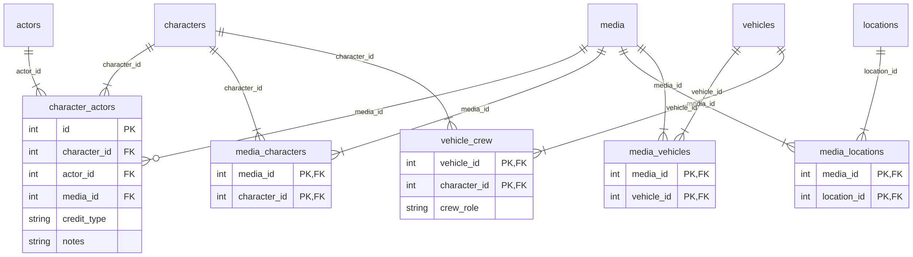
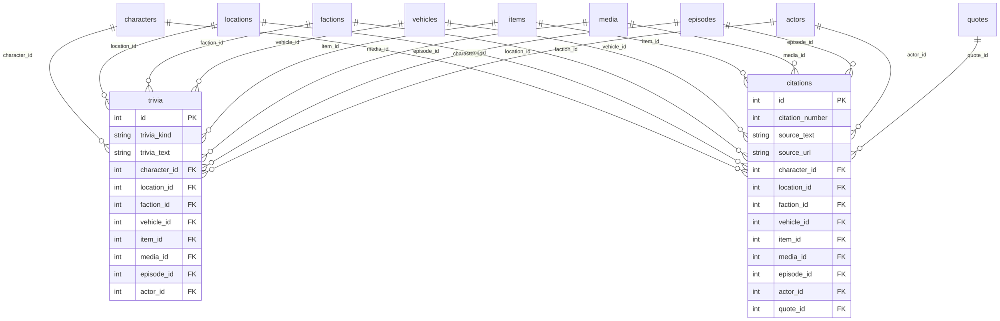
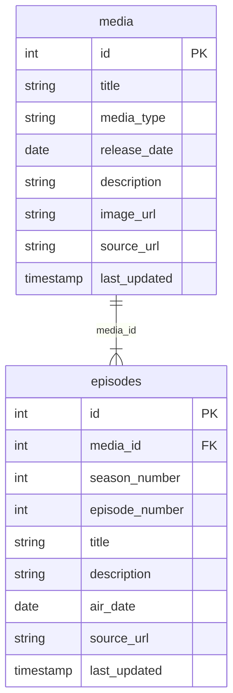
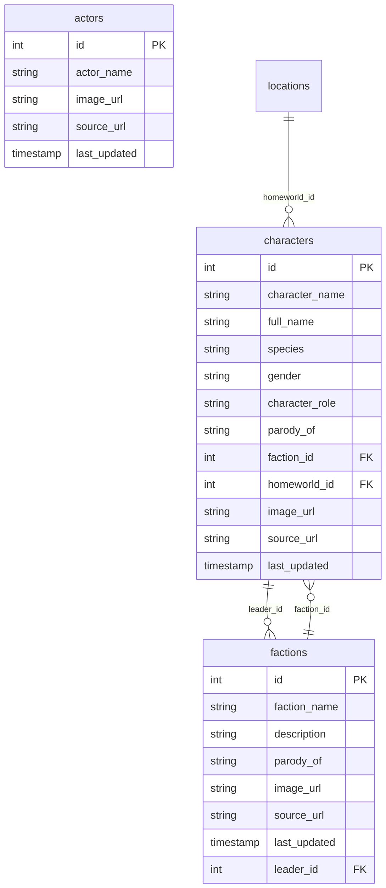
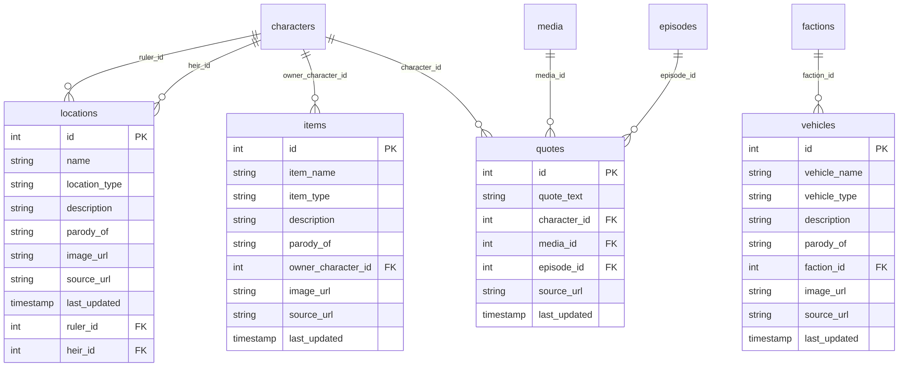

# SBAPI Entity Relationship Diagram

Auto-generated from `sbapidatabase_schema.sql` by `scripts/generate_erd.py`. Do not edit by hand — rerun the script after changing the schema.

## Overview

Full relationship graph, no columns (see the per-domain diagrams below for detail).

## Relationships

## Annotations

## Media

## People

## Things

## Tables

### actors

| Column | Type | Key |
|---|---|---|
| id | SERIAL | PK |
| actor_name | VARCHAR |  |
| image_url | VARCHAR |  |
| source_url | VARCHAR |  |
| last_updated | TIMESTAMPTZ |  |

### character_actors

| Column | Type | Key |
|---|---|---|
| id | SERIAL | PK |
| character_id | INTEGER | FK → characters |
| actor_id | INTEGER | FK → actors |
| media_id | INTEGER | FK → media |
| credit_type | VARCHAR |  |
| notes | TEXT |  |

### characters

| Column | Type | Key |
|---|---|---|
| id | SERIAL | PK |
| character_name | VARCHAR |  |
| full_name | VARCHAR |  |
| species | VARCHAR |  |
| gender | VARCHAR |  |
| character_role | VARCHAR |  |
| parody_of | VARCHAR |  |
| faction_id | INTEGER | FK → factions |
| homeworld_id | INTEGER | FK → locations |
| image_url | VARCHAR |  |
| source_url | VARCHAR |  |
| last_updated | TIMESTAMPTZ |  |

### citations

| Column | Type | Key |
|---|---|---|
| id | SERIAL | PK |
| citation_number | INTEGER |  |
| source_text | TEXT |  |
| source_url | VARCHAR |  |
| character_id | INTEGER | FK → characters |
| location_id | INTEGER | FK → locations |
| faction_id | INTEGER | FK → factions |
| vehicle_id | INTEGER | FK → vehicles |
| item_id | INTEGER | FK → items |
| media_id | INTEGER | FK → media |
| episode_id | INTEGER | FK → episodes |
| actor_id | INTEGER | FK → actors |
| quote_id | INTEGER | FK → quotes |

### episodes

| Column | Type | Key |
|---|---|---|
| id | SERIAL | PK |
| media_id | INTEGER | FK → media |
| season_number | INTEGER |  |
| episode_number | INTEGER |  |
| title | VARCHAR |  |
| description | TEXT |  |
| air_date | DATE |  |
| source_url | VARCHAR |  |
| last_updated | TIMESTAMPTZ |  |

### factions

| Column | Type | Key |
|---|---|---|
| id | SERIAL | PK |
| faction_name | VARCHAR |  |
| description | TEXT |  |
| parody_of | VARCHAR |  |
| image_url | VARCHAR |  |
| source_url | VARCHAR |  |
| last_updated | TIMESTAMPTZ |  |
| leader_id | INTEGER | FK → characters |

### items

| Column | Type | Key |
|---|---|---|
| id | SERIAL | PK |
| item_name | VARCHAR |  |
| item_type | VARCHAR |  |
| description | TEXT |  |
| parody_of | VARCHAR |  |
| owner_character_id | INTEGER | FK → characters |
| image_url | VARCHAR |  |
| source_url | VARCHAR |  |
| last_updated | TIMESTAMPTZ |  |

### locations

| Column | Type | Key |
|---|---|---|
| id | SERIAL | PK |
| name | VARCHAR |  |
| location_type | VARCHAR |  |
| description | TEXT |  |
| parody_of | VARCHAR |  |
| image_url | VARCHAR |  |
| source_url | VARCHAR |  |
| last_updated | TIMESTAMPTZ |  |
| ruler_id | INTEGER | FK → characters |
| heir_id | INTEGER | FK → characters |

### media

| Column | Type | Key |
|---|---|---|
| id | SERIAL | PK |
| title | VARCHAR |  |
| media_type | VARCHAR |  |
| release_date | DATE |  |
| description | TEXT |  |
| image_url | VARCHAR |  |
| source_url | VARCHAR |  |
| last_updated | TIMESTAMPTZ |  |

### media_characters

| Column | Type | Key |
|---|---|---|
| media_id | INTEGER | PK, FK → media |
| character_id | INTEGER | PK, FK → characters |

### media_locations

| Column | Type | Key |
|---|---|---|
| media_id | INTEGER | PK, FK → media |
| location_id | INTEGER | PK, FK → locations |

### media_vehicles

| Column | Type | Key |
|---|---|---|
| media_id | INTEGER | PK, FK → media |
| vehicle_id | INTEGER | PK, FK → vehicles |

### quotes

| Column | Type | Key |
|---|---|---|
| id | SERIAL | PK |
| quote_text | TEXT |  |
| character_id | INTEGER | FK → characters |
| media_id | INTEGER | FK → media |
| episode_id | INTEGER | FK → episodes |
| source_url | VARCHAR |  |
| last_updated | TIMESTAMPTZ |  |

### trivia

| Column | Type | Key |
|---|---|---|
| id | SERIAL | PK |
| trivia_kind | VARCHAR |  |
| trivia_text | TEXT |  |
| character_id | INTEGER | FK → characters |
| location_id | INTEGER | FK → locations |
| faction_id | INTEGER | FK → factions |
| vehicle_id | INTEGER | FK → vehicles |
| item_id | INTEGER | FK → items |
| media_id | INTEGER | FK → media |
| episode_id | INTEGER | FK → episodes |
| actor_id | INTEGER | FK → actors |

### vehicle_crew

| Column | Type | Key |
|---|---|---|
| vehicle_id | INTEGER | PK, FK → vehicles |
| character_id | INTEGER | PK, FK → characters |
| crew_role | VARCHAR |  |

### vehicles

| Column | Type | Key |
|---|---|---|
| id | SERIAL | PK |
| vehicle_name | VARCHAR |  |
| vehicle_type | VARCHAR |  |
| description | TEXT |  |
| parody_of | VARCHAR |  |
| faction_id | INTEGER | FK → factions |
| image_url | VARCHAR |  |
| source_url | VARCHAR |  |
| last_updated | TIMESTAMPTZ |  |
